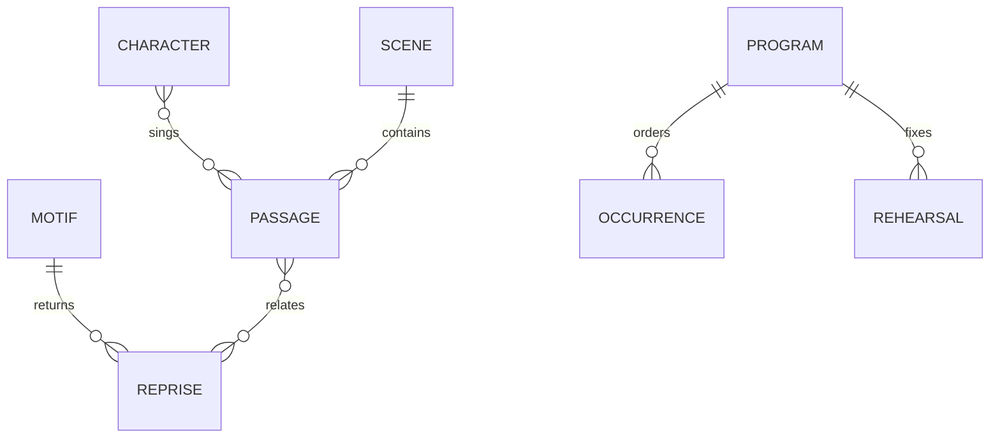

# 领域与本体设计

## 专业聚合

Evidence固定引文、Character演唱人物、Scene戏剧场景、Passage对白/歌曲段落、Motif主题、Reprise主题再现、Program演出编排、Rehearsal排练快照、Note意见。根字段：evidence、characters、scenes、passages、motifs、reprises、programs、rehearsals、notes、basis_refs。专业对象以WorkRef＋owner_plugin_id＋object_id确定身份，revision＋sha256固定内容。相同标题不代表同一对象。

段落区分对白、歌曲与过渡，歌曲有明确演唱者、逐行分工、戏剧目标及整数节拍；多人同唱通过同一明确节拍位置表达，不按行数相加。节拍单位为四分音符的960ticks，估时用整数有理数与明确BPM；未知BPM或对白估时保留未知。编排按独立出场记录，可重复同一段落。主题再现固定原段与回归段的组合摘要，反序或未出现原段明确警告；不把相似词项自动认定为再现。排练保存完整使用快照，记录仅为提交者声明。正式歌词资料与乐谱可用固定来源引用，专业段落不替代Owner正文。

所有集合ID唯一、所有引用存在、集合有界、顺序在对应父级唯一。撤销先处理依赖，不能制造悬空引用；来源索引只追加，整本保存不能改变原索引意义。跨包引用只携带固定Owner、对象、修订与摘要，通过公开SDK回读，不导入对方私有结构。

## 权属

原始资料、作品身份与受管事务归Core；专业记录归本包；理解、创作与解释归作者选择的外部Agent；表达取舍与定稿归作者。借助欧卡姆原理复用通用事实，只增加本旅程需要的专业状态。
